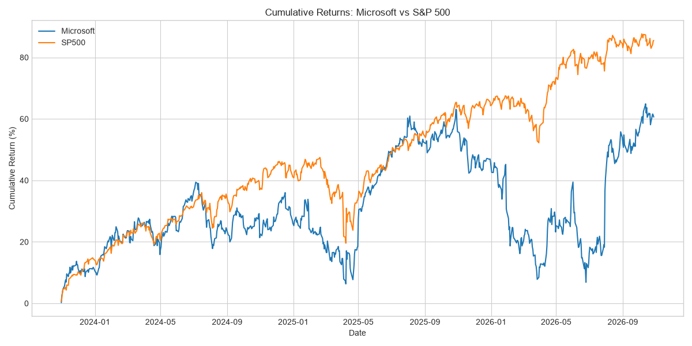
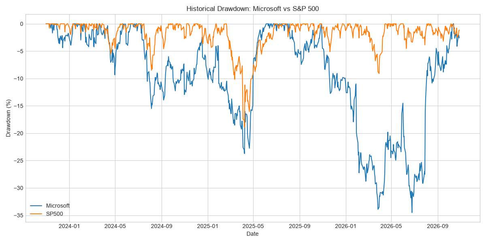

# Microsoft (MSFT) vs. S&P 500: A 3-Year Risk-Return Analysis

> A Python-based performance and risk comparison of Microsoft stock against the S&P 500 benchmark, covering cumulative return, CAGR, volatility, Sharpe ratio, and maximum drawdown.

**Analyst:** [Your Name] | **Tools:** Python, pandas, NumPy, Matplotlib, yfinance | **Period:** 30 Oct 2023 – 27 Oct 2026 (751 trading days)

---

> **Prefer a PDF?** See the [Project Overview (PDF)](docs/project_overview.pdf) for objectives, workflow, and a technical skills summary.

---

## 1. Executive Summary

Over the last three years, **Microsoft returned less than the S&P 500 while taking on materially more risk.** An investor holding the index would have earned a higher return, with lower volatility and shallower losses along the way.

| Metric | Microsoft (MSFT) | S&P 500 |
|---|---:|---:|
| Cumulative return | 61.21% | **85.34%** |
| Annualized return (CAGR) | 17.32% | **22.92%** |
| Annualized volatility | 26.15% | **14.93%** |
| Sharpe ratio (0% risk-free) | 0.74 | **1.46** |
| Maximum drawdown | -34.50% | **-18.90%** |

**Key takeaways**

1. **Lower return:** MSFT trailed the index by about 24 percentage points cumulatively, or roughly 5.6 points per year.
2. **Higher risk:** MSFT's volatility was about 1.75x the index's, and its worst drawdown was about 1.8x as deep.
3. **Weaker risk-adjusted return:** MSFT's Sharpe ratio (0.74) was roughly half the S&P 500's (1.46). Each unit of risk earned about half as much return.
4. **Recovery in progress:** MSFT's final close of $531.33 sits about 2% below its period high of $543.45, so most of the deep 2026 drawdown has been recovered.

---

## 2. Business Question

> *Did holding Microsoft over the past three years compensate an investor for the extra risk of owning a single stock, compared with a simple S&P 500 index position?*

This is a common question in equity research and portfolio construction, because single-stock exposure should be justified by a return premium over the diversified benchmark.

---

## 3. Data & Methodology

**Data source:** Daily adjusted closing prices from Yahoo Finance via the `yfinance` library (`auto_adjust=True`, so MSFT prices reflect splits and dividends).

| Item | Detail |
|---|---|
| Assets | Microsoft (`MSFT`), S&P 500 index (`^GSPC`) |
| Window | 30 Oct 2023 to 27 Oct 2026 |
| Observations | 751 daily closes, 0 missing values, 0 duplicate dates |
| Validation | Automated assertions: non-empty data, unique dates, strictly positive prices |

**Metric definitions**

| Metric | Formula |
|---|---|
| Daily return | `pct_change()` of closing price |
| Cumulative return | `(1 + r).cumprod() - 1` |
| CAGR | `(1 + cumulative return)^(1 / years) - 1`, using calendar years |
| Annualized volatility | `std(daily returns) × √252` |
| Sharpe ratio | `(mean daily return × 252) / annualized volatility`, with a 0% risk-free rate |
| Drawdown | `wealth index / running peak - 1`; maximum drawdown is the minimum of this series |

---

## 4. Analysis & Findings

### 4.1 Price history
Microsoft traded between **$329.59 and $543.45** over the window, with a mean of $432.26 and a median of $417.60. The mean sits above the median, which reflects the stock spending more time at higher price levels in the later part of the period.

### 4.2 Cumulative returns
Both assets rose strongly, but the S&P 500 compounded faster: **+85.34% vs. +61.21%**, or 22.92% vs. 17.32% annualized.



### 4.3 Volatility
MSFT's annualized volatility of **26.15%** was well above the index's **14.93%**. Part of this gap is structural. An index diversifies across roughly 500 companies, while a single stock carries company-specific risk that diversification would otherwise remove.

### 4.4 Drawdown analysis
MSFT's maximum drawdown reached **-34.50%**, against **-18.90%** for the S&P 500.



Reading the chart:
- The **S&P 500's deepest decline appears around spring 2025**, and the index recovered quickly afterward.
- **MSFT's deepest and longest drawdown came in 2026.** It began around January and stayed severe for several months, bottoming around mid-year before a sharp recovery in late summer.
- MSFT's drawdowns were deeper and lasted longer than the index's throughout the period. This pattern is consistent with the higher volatility reading.

### 4.5 Risk-adjusted performance
The Sharpe ratio condenses return and risk into one number. **MSFT scored 0.74 against 1.46 for the S&P 500**, so over this window the single-stock position did not earn a premium that compensated for its extra risk.

---

## 5. Conclusion & Business Implications

- For an investor whose goal is **risk-adjusted growth**, the S&P 500 was the more efficient holding over this window.
- Owning MSFT was justified only if the investor had a **high risk tolerance and a conviction view**, since the drawdown could have exceeded a third of portfolio value.
- If MSFT is held for its strengths, it is better sized as **a position within a diversified portfolio** than as a stand-in for broad equity exposure.

---

## 6. Limitations

A strong analysis states its own limits:

1. **Single window.** Three years is one market regime. Rankings can change over other horizons, so results should not be extrapolated.
2. **Benchmark methodology.** `^GSPC` is a price index and excludes dividends, while the adjusted MSFT series includes them. This slightly **understates** the S&P 500's total return, so the true gap in the index's favor may be somewhat larger. Using a total-return series such as `^SP500TR` or the SPY ETF would be a cleaner comparison.
3. **Risk-free rate.** The Sharpe ratio assumes 0%. Using a Treasury bill yield would lower both ratios and shrink the gap between them in absolute terms.
4. **Descriptive, not causal.** The analysis shows *what* happened, not *why*. It does not attribute MSFT's 2026 drawdown to any specific driver.
5. **Live data.** The notebook downloads current data each run, so figures will shift slightly with the run date.

---

## 7. Suggested Next Steps

- Add a **beta and alpha** regression of MSFT against the S&P 500 to separate market exposure from stock-specific return.
- Use a **risk-free rate series** (e.g., 3-month T-bill) for a proper Sharpe ratio.
- Add **rolling 1-year returns and volatility** to show how the relationship changed over time.
- Extend to peers (AAPL, GOOGL, AMZN, NVDA) and a **sector benchmark** such as the Nasdaq-100 or XLK.
- Calculate **Sortino ratio** and **Value-at-Risk** to focus on downside risk specifically.
- Link the 2026 drawdown to **earnings events and news** for a causal narrative.

---

## 8. Repository Structure

```
msft-stock-performance-risk-analysis/
├── docs/
│   └── project_overview.pdf         # objectives, workflow, technical skills
├── notebooks/
│   └── msft_stock_analysis.ipynb    # full analysis notebook
├── outputs/
│   ├── cumulative_returns.png       # chart used in this report
│   └── drawdown.png                 # chart used in this report
├── README.md
└── requirements.txt
```

## 9. How to Reproduce

```bash
git clone https://github.com/<your-username>/msft-stock-performance-risk-analysis.git
cd msft-stock-performance-risk-analysis
pip install -r requirements.txt
jupyter notebook notebooks/msft_stock_analysis.ipynb
```

Run all cells from top to bottom. An internet connection is required to download price data. The final cell also writes two CSV files (performance summary and daily returns) to the working directory.

---

## 10. Skills Demonstrated

**Financial analysis:** return and risk measurement, Sharpe ratio, drawdown analysis, benchmark comparison
**Technical:** Python, pandas, NumPy, Matplotlib, Seaborn, API-based data collection (yfinance)
**Data quality:** missing-value and duplicate checks, assertion-based validation, timezone normalization
**Communication:** translating quantitative results into a clear investment conclusion with stated limitations

---

## Contact

**[Your Name]** | [LinkedIn URL] | [Email] | [Portfolio/GitHub URL]

*Disclaimer: This project is for educational and portfolio purposes only. It is not investment advice.*
